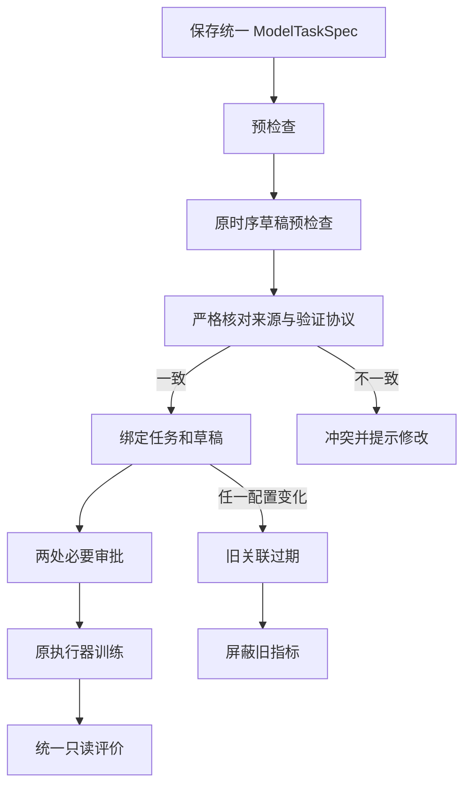

# TimePilot v0.39.2：时序模型证据对齐、PIT 约束与逐项审阅

审阅基线：v0.39.1 源码候选包。目标：让四类模型任务拥有同源、可核验的评价读取入口，收束双草稿审批和时间留出中的前视泄漏风险。2026-11-20。

## 1. 结论与证据边界

当前系统的普通回归和普通二分类已有实际 scikit-learn 同折训练；连续时序预测和工序提前分类继续使用原有 PIT 感知执行器。本版新增 `TemporalTaskBridge`，把 `ModelTaskSpec` 与既有时序草稿进行**严格的来源、字段和协议绑定**，并通过项目级 API 返回经过过滤的评价摘要。时间留出普通模型增加**逐行检查决策时间、特征发布时间和训练标签成熟时间**。重复保存无变化的模型合同保留原审批；改变配置和来源严格失效。

本版**没有**把两套执行器合并为一套训练引擎，也没有增加可部署模型权重、在线推理、真实生产收益证明。双审批仍保留以兼容旧任务；统一接口仅汇聚已核验数据，不能用于跨协议直接比较模型收益。

## 2. 已落地改造及审阅

| 编号 | 代码位置 | 已确认的缺口 | v0.39.2 处理 | 验收与剩余风险 |
|---|---|---|---|---|
| P0-01 | `model_task_spec.py`、`modeling-ui.js` | 统一合同与旧执行器存在重复配置，且分类/预测混用不适宜的验证方式 | 连续预测使用 `rolling_origin`；提前分类使用 `temporal_holdout`；明确正负标签、目标、X、时间和成熟时间 | 需要在真实工厂数据重放模型预检和标签延迟 |
| P0-02 | `model_task_temporal_bridge.py` | 保存统一合同后无法安全恢复旧版时序草稿及其结果 | 建立项目内不可随意改写的关联；校验版本 SHA、字段顺序、频率、分折、预测跨度、时间可用性和训练范围；旧执行器无法表示的未来已知特征、逐 X 发布时间、独立决策时钟、gap 与分类窗口数差异均拒绝绑定 | 现有实体映射仅支持旧执行器的单实体字段；复杂多实体需单独扩展 |
| P0-03 | `model_task_api.py`、`api.py` | 普通与时序评价结果入口不同，难以追溯 | 新增 `POST/GET model-tasks/{task_id}/temporal-link` 与 `GET model-tasks/{task_id}/evidence` | 统一证据是只读摘要；没有实际模型权重和部署 API |
| P0-04 | `model_task_execution.py`、`model_task_store.py` | 时间留出回归/二分类可能在事件时间前使用尚未公布的 X，或把标签未成熟记录放进训练集 | 校验 feature available_at <= decision_time，确认训练标签在分折截止时已成熟，并记录分折级哈希、训练/验证时间边界 | 普通模型采用单次 80/20 时间留出；滚动验证与跨设备 PIT 对照后续实施 |
| P0-05 | `model_task_store.py` | 重复提交完全相同配置会撤销审批；修改来源后可能混入旧训练指纹 | 幂等保存不增加修订，不变审批；更换已绑定源版本拒绝隐式覆盖，需新建任务 | 兼容旧版测试修订并测试冲突 |
| P1-01 | `modeling-ui.js` | 已保存时序模型的草稿和评价在刷新后无法恢复 | 恢复时检查绑定是否过期，提供显式“核对模型评价”；旧数据不可展示为当前有效证据 | 真实 Chrome 与 Perspective 同库联调待目标 Mac 门禁 |
| P1-02 | `tests/*v0392*` | 未覆盖审批失效、数据范围偷换和实际 PIT 失败案例 | 加入真实 SQLite/FastAPI、PIT 分折、来源版本、跨项目拒绝访问及 Node 界面恢复测试 | 真实 DuckDB/Parquet、MES 多工况、独立盲标仍待验收 |

## 3. 统一任务与时序草稿的关联契约

请求示例：

```json
{"draft_id":"<UUID>","expected_revision":1}
```

路由（项目前缀为 `/api/v1/projects/{pid}`）：

```text
POST /model-tasks/{task_id}/temporal-link  核对并绑定原训练草稿
GET  /model-tasks/{task_id}/temporal-link  读取绑定、双审批和失效状态
GET  /model-tasks/{task_id}/evidence       按执行器输出只读评价摘要
```

新增 SQLite 表 `model_task_temporal_links`：`task_id` 主键、`project_id`、`revision`、`spec_sha256`、`source_sha256`、`draft_id`、`draft_revision`、`selection_sha256`、`execution_config_sha256`、`created_at`。采用当前项目目录事务及绑定哈希，旧执行配置与合同不匹配时拒绝复用。验证范围禁止过滤视图冒充全量资产。

状态示意：



## 4. PIT 与时间切分反例

普通回归和一般二分类使用时间留出时，检查以下关系：

- `event_time`：事件发生时间，决定训练/验证分界。
- `decision_time`：业务真实作出预测/判断的时刻；未指定时采用当前事件时间。
- `X available_at`：每个特征的发布时间，必须不晚于该行 `decision_time`。未知时要求明确业务认可的发布滞后假设。
- `Y label_available_at`：标签成熟/可用时刻；训练行的标签必须在分折截止时可用。
- `cutoff_utc`、`latest_train_event_utc`、`first_validation_event_utc`、`train_index_sha256` 和 `validation_index_sha256`：作为结果证据写入。

当前时间留出实现为一次按时间划分的 80/20 验证，`gap` 按训练记录数清除尾部，不能解释为业务小时数。时序预测使用原执行器滚动验证，**不同协议和分折不能直接对比提升百分比**。

### 必须通过的反例

1. 同一特征在决策之后才发布：拒绝评价。
2. 训练标签在测试起点仍未成熟：拒绝或剔除该训练记录，必要时因样本不足失败。
3. 审批后更新来源 SHA：拒绝复用旧指标。
4. 用带 BI 筛选的旧草稿关联全量资产合同：拒绝关联。
5. 修改分类正/负标签含义：旧关联过期。
6. 修改草稿或模型配置、切换版本、跨项目读取：不能读出旧当前结果。
7. 原配置完全相同的重复保存：不增加修订，不撤销审批。
8. 统一合同声明未来已知特征、逐 X 独立可用时刻、另一决策时钟、gap 或不同的分类窗口数，而旧执行器无法表达：拒绝关联。

## 5. 测试与发布门禁

回归命令：

```bash
python -m pytest -q tests/test_model_task_contract_v0390.py tests/test_model_task_api_integration_v0390.py tests/test_model_task_execution_v0391.py tests/test_model_task_temporal_bridge_v0392.py tests/test_model_task_pit_v0392.py
node --test frontend/native-bi/tests/*.test.mjs
bash TIMEPILOT.sh source-check
bash TIMEPILOT.sh release-gate --mode source
```

真实 Mac 完整门禁（目标 Python 3.12.12，DuckDB、PyArrow、Perspective 和预编译资产）：

```bash
bash TIMEPILOT.sh release-gate --mode physical
bash TIMEPILOT.sh release-gate --mode browser
bash TIMEPILOT.sh release-gate --mode offline --archive <完整离线包路径>
```

以实际 QA 报告中的退出码与逐项记录为准。缺依赖的物理/浏览器/离线门禁应返回 `BLOCKED=2`，不能当作通过。`source-check=PASS` 仅确认打包源码的 SHA 一致。

## 6. 下一版建议（v0.39.3）

优先统一**运行记录与结果合同**（包含来源、分折、指标、输出物和版本）并使四类任务可以在同一个成果工作台比较；在真正相同数据、相同样本/分折和相同预算下比较模型。其次实现时序滚动验证的可用性账本、跨设备外推和工序分类决策点的错误成本曲线。保持无标签不报告收益、负收益如实显示，以及所有模型结果都可关联原始数据与 SHA256。真实部署可用性必须继续以 Mac 物理、浏览器、离线三项 PASS 为前置条件。
